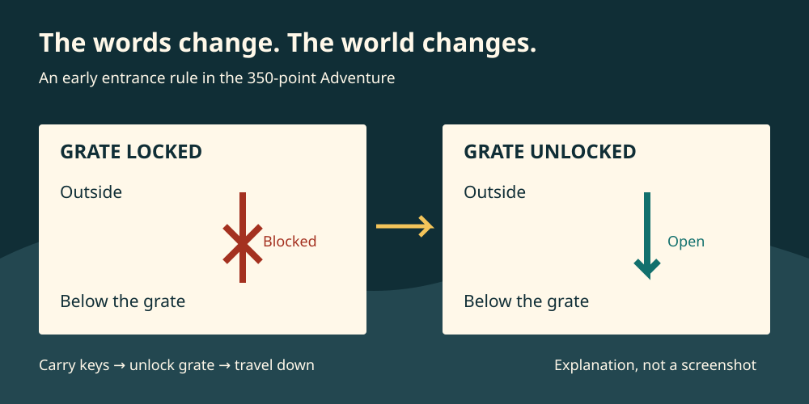

# Adventure: a world at the other end of a sentence

A locked grate is a modest obstacle. You can see it. You know where you want to go. You have even found some keys. The interesting part is persuading the computer to let you use them.

Type a direction and the game refuses to let you through. Unlock the grate, try again, and you are underground. No animation plays. Nothing on screen resembles a cave. Yet the place has changed, and the game will remember what you did.

That is a lovely trick. *Adventure*, also known as *Colossal Cave Adventure*, gives you a world made from descriptions and lets you interfere with it. You explore, collect things, get lost, experiment and occasionally discover that your sensible idea has met a very unreasonable cave.

Our reference here is the familiar **350-point Crowther and Woods game**, explored through Arthur O’Dwyer’s later C port. It is a modern way into a historical design, rather than a recording of a 1977 terminal. Crowther’s earlier game and later home-computer adaptations have important differences. [1][2]

## Start with somewhere you can picture

The opening puts you beside a road, a small building and a stream. These are useful things to give a new player. A building invites investigation; running water suggests a direction to follow. Before you have learnt much of the vocabulary, you have reasons to try something.

Entering the building reveals supplies, including keys and a lamp. Taking the lamp changes your inventory: the list of things you carry. Leaving and returning does not put it back on the floor. The description is a view of a continuing world, rather than the next page of a fixed story. [2]

**The screen describes the place. The program remembers the world.**

This distinction does a great deal of work. A room description supplies a setting; objects give you things to act upon; their changing states give those actions consequences. The game can describe a locked grate, let you unlock it, and allow a journey that was previously impossible.

*Our explanatory diagram of the entrance rule, not a historical screenshot or a complete cave map. It reveals this early obstacle’s solution.*

## Learning to talk to the cave

The keyboard does two jobs. You use words to travel, and words to act. A direction such as `WEST` moves you along a route if one is available. A command such as `TAKE LAMP` asks for an action on an object. `INVENTORY` lets you inspect what you are carrying.

The part of the program that recognises these requests is the **parser**. In this version it works with a limited vocabulary and up to two input words. It does not understand every sentence a person might say. Knowing that difference makes the game much less mysterious: failure can mean that an action is impossible, but it can also mean that the wording has not matched anything the program recognises. [2]

That is both an invitation and a source of friction. You can imagine far more actions than the author could reasonably implement. A description might make you want to touch something, climb it, break it or ask about it. The game has to give a useful response, or leave you wondering whether your idea or your vocabulary was wrong.

Try the opening building as a small example. `IN` gets us inside, but `SOUTH` does not get us out again in the tested port. `OUT` does. A player’s picture of a place and the program’s recognised routes are related, but they are not identical. We learn the cave’s language while learning its geography.

## Making a map in your head

Spacewar lets us watch ships move. Adventure asks us to construct space from what we read.

Some passages are easy to understand: leave one location and arrive at another. But the program does not need to draw a continuous landscape or give every place a position on a square grid. It stores connections between locations, with conditions governing some journeys. A route can depend on an object, a previous action or the way you try to travel. [2][3]

A paper map becomes a record of discoveries. Which way did we come? Does that exit take us back? Are two similar descriptions the same place? The maze makes these questions particularly sharp: recognising a sentence is not always enough to know where you are.

That can be satisfying when a pattern becomes clear. It can also be exhausting. Repeated descriptions and uncertain routes make navigation itself a puzzle, which is a different pleasure from exploring a world whose geography stays easy to read. We should give the game credit for the possibilities it opens without pretending every player will enjoy every obstruction.

## Take the lamp. Then think about the lamp

A light is such a small object to carry into a large adventure. It changes almost everything.

The lamp lets you explore darkness, but its power is limited in the 350-point game. Carrying space is limited too. These rules turn a list of useful objects into a set of choices: what should come with us, what can wait, and how much wandering can we afford? The light limit and its relationship to the introductory instructions are implementation details that vary; a number from this port should not be treated as a rule for every Adventure. [2][3]

The cave also contains hazards and encounters whose outcomes are not all determined by your latest command alone. Random behaviour means that a remembered route is not a promise of an identical journey. Death, lost progress and the possibility of returning add stakes, though the cost of repeating work can also discourage experimentation.

These systems pull against one another. Exploration rewards curiosity; a limited light makes aimless exploration expensive. Collecting objects expands your options; a carrying limit stops you taking every option everywhere. The design becomes interesting where those pressures meet.

## Treasure gives the journey a shape

The 350-point score makes progress visible. Finding treasure matters, but bringing it back to the building matters more. Exploration therefore develops into an expedition: set out, learn something, find a way through, and work out how to get your gains home. [2][3]

Objects are more than prizes. They can be tools, clues and complications. A puzzle can ask you to notice a detail, connect two things you have found, or reconsider what an object might do. The game’s mixture of practical obstacles and magic also means that ordinary common sense will only take you so far.

There is a weakness here as well as a strength. Once you know a solution, an apparently baffling encounter can seem inevitable. Before that moment, several equally plausible experiments may produce little useful feedback. A good study needs to examine what the player could reasonably infer at the time, rather than admire the answer with hindsight.

The ending gives the treasure hunt a further change of pace. We are keeping its solutions out of this opening investigation: the point is to understand the game’s shape without handing over a route through every puzzle.

## A real cave, and an imagined one

Will Crowther brought experience of caving and cave surveying to the game he wrote in the 1975–76 period. The Bedquilt region of Kentucky’s Colossal Cave supplied recognisable places and passages. Dennis Jerz’s research compared the recovered program with cave records, interviews and an actual visit, finding a much closer relationship than a generic underground setting. [1]

The surveying was collaborative work. Patricia Crowther, later Patricia Wilcox, was an experienced caver and an important participant in the mapping work. That contribution helps explain the world behind the game; it is not evidence that she programmed Adventure. [1]

Crowther also played Dungeons & Dragons. The original already mixed its recognisable cave with fantasy, puzzles and danger. Don Woods did not take a neutral survey and turn it into a game from nothing. In 1977 he expanded an existing imaginative work, adding locations and elaborating objects, encounters, scoring and an endgame. [1][3]

This combination is part of the appeal. Water, rock and awkward passages make the cave feel like somewhere that might exist. Magic and unexpected creatures keep it from settling into a simulation. Learning which expectations apply becomes part of exploring.

Crowther’s accounts of making a game his children could enjoy offer another useful view of its origins. The circumstances belong to particular people and their recollections. We do not need to invent an emotional explanation for each design decision to see how family, friendship, work and a shared enthusiasm for caves could meet in one program. [1]

## A game that could travel

Adventure emerged around large shared computers, rather than a home-computer shop shelf. Crowther worked at Bolt Beranek and Newman; Woods encountered the game at Stanford. Academic and research computing communities, network connections and source exchange helped it reach people who could play, modify and translate it. That was substantial circulation within a particular environment, not universal access to computers. [1]

The surviving FORTRAN version separates much of its location text and travel information from the program that applies the rules. Later ports carried the game onto other systems, although a translation can introduce changes or mistakes. Our tested C port’s own notes are refreshingly clear about that possibility. [2][3]

Words made a large imagined place possible without drawing every view. That does not make the text free: descriptions take storage, commands need vocabulary, and a growing world needs a coherent set of rules. But it provides a different bargain from drawing the same place in pictures. The reader supplies its appearance.

## Coming home

[Level 9](https://code198x.com/vault/companies/level-9/)’s *Colossal Adventure* made the mainframe adventure into a home-computer product and extended it. The BBC Micro manual examined here describes an enlarged endgame, compact adventure instructions and compressed text. It also offers a postal clue service. The packaging now had work to do that the game itself no longer did: explain how to load, play and seek help. This is evidence about that documented edition, not proof that every release behaved identically. [4]

The same manual promotes approachable English instructions while admitting that the program recognises vocabulary rather than understanding language. That is a useful glimpse of both the sales pitch and the practical bargain offered to a customer.

Spectrum adventures deserve their own attention. CRASH’s April 1985 adventure chart includes *Colossal Adventure*, *Snowball*, *The Hobbit* and several other kinds of adventure together. It shows some of the variety readers were discussing; it is neither a census nor a family tree. [5]

From here, [The Quill](https://code198x.com/vault/tools/the-quill/) offers a natural next question: what changes when more people can author an adventure without writing the whole engine? [The Hobbit](https://code198x.com/vault/games/the-hobbit/) raises different questions about language, characters and illustrated places. Neither needs to be reduced to a step on an inevitable march away from text. Pictures can add information and atmosphere while words continue to do important work.

## Why come back to it?

Adventure makes a remarkable amount happen between a description and a prompt. You picture a place, propose an action, read the response and revise your understanding. The program supplies enough consistency for that imagined world to hold together, then enough surprise to make you want to go further.

We can learn from its frustrations as well as its successes: how to teach a vocabulary, make consequences readable, distinguish a blocked action from a misunderstood request, and reward exploration without making every failed experiment costly.

For the broader history, the [Vault’s Adventure entry](https://code198x.com/vault/games/colossal-cave-adventure/) and [text-adventure overview](https://code198x.com/vault/genres/text-adventure/) supply further reading. Here the grate is a good place to begin. A few words change its state. A new route opens. The cave is waiting.

## Sources

1. Dennis G. Jerz, [“Somewhere Nearby is Colossal Cave: Examining Will Crowther’s Original ‘Adventure’ in Code and in Kentucky”](https://dhq.digitalhumanities.org/vol/1/2/000009/000009.html), *Digital Humanities Quarterly* 1.2 (2007). Research based on recovered source, interviews, cave records and field investigation; retrospective testimony is identified as such.
2. Arthur O’Dwyer, [ODWY0350 implementation](https://github.com/Quuxplusone/Advent/tree/142b61f37063cb00bc9037f67b19411f257099b1/ODWY0350) and [port history](https://github.com/Quuxplusone/Advent/blob/142b61f37063cb00bc9037f67b19411f257099b1/README). Our bounded entrance observations are recorded separately.
3. Crowther and Woods, [350-point FORTRAN source and data](https://github.com/Quuxplusone/Advent/tree/142b61f37063cb00bc9037f67b19411f257099b1/WOOD0350). Preservation provenance and differences from the tested port are in the evidence record.
4. Level 9 Computing, [*Colossal Adventure* manual, BBC Micro loading instructions](https://mocagh.org/rainbird/colossaladv-manual.pdf), especially printed sections “The Game”, “How to Load and Start”, “Hints” and “Implementation”. The scan’s hosting folder is not an edition identification.
5. [CRASH issue 15, “Hotline”](https://www.crashonline.org.uk/15/hotline.htm), April 1985. Use the adventure chart, rather than treating the main Top 30 as a text-adventure chart.
