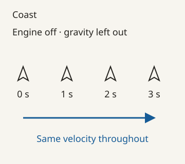
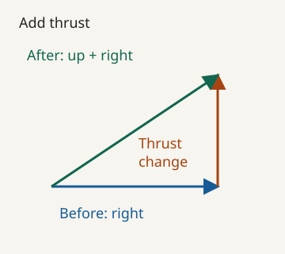
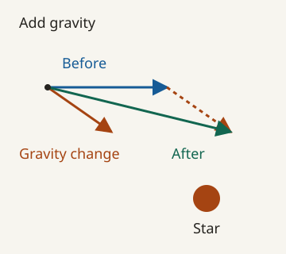
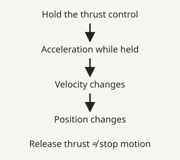

# Spacewar!: a universe worth playing in

You turn your ship towards your opponent and fire. The shot misses. You swing round for another attempt, but your ship is still travelling in the direction you sent it a moment ago. Now you need to think about where you're going as well as where you're pointing. Meanwhile, the other player has plans of their own.

There's a lot happening between those few marks on the screen.

Spacewar! brought a space battle to the PDP-1 computer at MIT in 1962. Two people could steer, shoot and try to outwit each other in a world that responded while they played. Its makers gave them enough to get into trouble, enough to develop some skill, and another person to surprise them. More than sixty years later, that's still an inviting combination. [1][source-1]

Getting the ship to do what you want is only the beginning. The person beside you is learning too.

## Pointing, moving and changing your mind

Your ship is drifting right. Turn it to face upwards. Where does it go next?

It keeps drifting right. Facing and moving are different things. **Velocity** describes how fast something moves and in which direction. Turning the ship changes where its nose points; it doesn't by itself replace the velocity it already has.

*First, leave gravity out. The engine is off and nothing is changing the ship's velocity. Equal distances in equal times mean a steady speed. The ship can point upwards throughout.*

Now fire the engine. Thrust produces **acceleration**: a change in velocity over time. It adds an upward change to the rightward motion you already had. The ship starts travelling up and right. Release thrust, and that new motion carries on unless something else changes it. Acceleration can change direction as well as speed. [8][source-8]

*The blue arrow is the old velocity. Add the orange change from a short upward burn. The green arrow is the result. These are velocity arrows, not a map of the flight path.*

That's why escaping takes more thought than pointing away from trouble. You need to change the motion you've already got. To brake a rightward drift, point left and thrust. Keep burning after you've cancelled that drift and you'll start moving left. A button press can solve one problem and start the next.

Now put the star back. Gravity accelerates the ship towards it, so your velocity keeps changing even with the engine off. A ship already moving sideways can follow a curved course as gravity pulls it inward. The next diagram shows one small change, before the ship has moved on and the direction towards the star changes again.

*Gravity supplies another change in velocity. The dashed orange arrow repeats that change at the tip of the old velocity so we can add them. The green result is the new velocity; it isn't an orbit prediction.*

Now your opponent has to judge a changing course. So do you. A shot aimed at where the other ship is now can miss where it will be when the torpedo arrives. Graetz's 1962 description adds another wrinkle: a torpedo inherits its ship's velocity as well as its launch velocity. The ship's motion becomes part of the shot. [2][source-2]

We can work with all of this as horizontal and vertical amounts. Add each change to the matching part of velocity, then use the new velocity to move the ship. That's a small numerical model we can draw, calculate and eventually program.

In [Maths for Games](https://code198x.com/craft/maths-for-games/), [Place a point](https://code198x.com/craft/maths-for-games/unit-06/) introduces coordinates, and [Keep fractional movement in integers](https://code198x.com/craft/maths-for-games/unit-11/) shows how a stored velocity becomes a change of position on each tick. Spacewar! gives those ideas a pressing purpose: getting your ship and your shot where you want them. Gravity and changing velocity take the investigation further.

## Enough physics for a space battle

Spacewar! borrows from physics and chooses its own rules. Graetz's technical account describes gravity acting on ships but not torpedoes. Real gravity doesn't make that distinction. The game does. [2][source-2]

That choice changes the contest. A ship follows a course under gravity while its shot travels without that pull. You have to judge two different sorts of movement at once. The familiar idea of a space battle has become a particular set of rules to learn.

Many games work this way. They borrow motion, friction, collisions or steering from the world around us, then simplify or alter them for the experience they want. Even a physics-based game has to choose what to calculate, how often to update it and how much precision to keep. Our Maths for Games velocity experiment makes one of those compromises visible: rounding the stored numbers can turn a hit into a miss.

The diagrams here isolate the ideas so we can see them. They're original explanations of motion, rather than captured frames or a reconstruction of the PDP-1's calculations.

Steve Russell later recalled preferring settings that left more time for marksmanship. Once the rules are in place, their pace is another choice. How much time should a player have to read a course, line up a shot and react? [3][source-3]

## Space battles begin somewhere

The ships came from a world beyond the computer room.

In his 1981 account, Martin Graetz remembered the group's enthusiasm for E. E. “Doc” Smith's *Skylark* and *Lensman* stories, science-fiction films and imaginary screen adventures of their own. Books, cinema and conversations helped supply the setting they wanted to play in. [4][source-4]

A few marks can carry an enormous amount of imagination. Call a shape a spaceship, let someone steer it, and give it a convincing response: there's room for the player to supply much of the adventure.

We do it whenever we become absorbed in a game whose graphics leave plenty unsaid. Someone steeped in space adventures may read those shapes differently from someone meeting them for the first time. The picture leaves space for both.

The people making the game also had lives beyond their shared enthusiasm. Graetz recalled Wayne Wiitanen, who helped conceive Spacewar!, being called to active military duty during the Berlin crisis. That took him away from its development. [4][source-4]

## Making the battle readable

Once you've imagined a space battle, you still have to make it playable.

The ships need to look different enough for each player to recognise their own. Their outlines need to show which way they're facing. Exhaust can tell us when a ship is thrusting. Graetz's contemporary account describes these choices, along with a wonderfully awkward problem: torpedoes drawn as points can resemble the stars behind them. [2][source-2]

Look at how much those small visual decisions are being asked to do. A shape helps you find your ship, read its direction and decide what to do next. Movement helps you tell a threat from the background. When attention is divided between two ships and an incoming shot, that information has to earn its place.

Try changing a ship's outline in a sketch, or imagine removing its exhaust. What becomes harder to read? More detail might help, but which detail helps the player act?

## The game in your hands

In a 2008 interview, Russell remembered controllers with quiet switches. Why did quiet matter? Because otherwise an opponent could hear you trying to fire after you'd run out of ammunition. The controls could give away your predicament. He also recalled earlier controls wearing out under heavy use. [3][source-3]

The controller affects what each player knows, as well as what they can do. Even the sound of a switch can become part of the contest.

A switch also gives a particular kind of instruction: on or off. Hold a thrust control and the game keeps applying thrust; releasing it ends that instruction. It doesn't mean “stop the ship”. The physics and the meaning of the control have to agree.

*Releasing the control removes thrust's contribution. Gravity can still be acting.*

Other devices give games different information. Here are some possible uses:

| Device | What the game can work with |
|---|---|
| Digital joystick or buttons | On/off directions and button states: apply thrust or turning while held, or trigger an action. |
| Analogue joystick | A graduated position: vary thrust or steering with how far the stick moves. |
| Mouse or trackball | Relative movement: move a pointer, aim or turn by an amount chosen by the game. |
| Steering wheel | Steering position, sometimes with force feedback: turn and feel resistance or effects. |
| Light gun | Pointing at a display target: aim directly rather than steer a cursor towards it. |

The device supplies input; the game chooses its meaning. A joystick's position can set a target, a speed or a turning rate. [9][source-9] The same hand movement can mean something quite different after the designer has interpreted it.

Spacewar! lets us keep the question concrete: what should turning a control change, and what should happen when we let go? Our [Game Feel](https://code198x.com/craft/game-feel/) experiments compare immediate movement with acceleration and different release behaviour. The input is only the beginning of the response.

## More hands, a better game

Russell wrote the first implementation, but the Spacewar! we remember grew through other people's work. Graetz and Wiitanen shared in its conception; Peter Samson and Dan Edwards contributed to its development. The Computer History Museum's account gives us a group making something together. [1][source-1]

Graetz's later recollection describes overlapping work and additions prompted by what people wanted the game to do better. A starfield could help make movement readable. Gravity could give the contest another dimension. Better controls could improve the experience of playing. [4][source-4]

It's easy to look backwards and see a finished design waiting to be discovered. The more interesting story is people noticing an opportunity, making a change and giving one another something new to respond to.

A feature earns its keep through what it does for the experience. A handsome background might also help you judge motion. A physical switch might be comfortable but reveal information you meant to conceal. We can learn a great deal by asking what a change solved, and what new trouble it introduced.

## How do you share a game in 1962?

There was no home-computer cassette to take to the counter. The April 1962 *Decuscope* account offered symbolic and binary program tapes through Russell. Reaching another player meant reaching someone with a suitable computer and the means to run the program. The same account describes people watching as well as playing. [5][source-5]

A retail game's box has to attract a buyer and promise an experience. Spacewar! could put an experience in front of an audience directly. The museum describes it being used to demonstrate the PDP-1 to prospective customers. Here was something a visitor could watch happening, with human decisions producing visible results. [1][source-1]

Ten years later, Stewart Brand's *Rolling Stone* report took readers into organised Spacewar play at Stanford, with spectators and competition around a PDP-10 variant. This was a later game scene on a different machine, with different match arrangements. The activity had continued to develop around the program. [6][source-6]

A decade after its creation, people were still finding reasons to play, change and compete at Spacewar! A game first shared on program tapes had become an activity people organised around.

## Take the controls

You can explore Spacewar! in [Norbert Landsteiner's browser emulator](https://www.masswerk.at/spacewar/). For this study, we've selected the edition labelled **Spacewar! 3.1, 24 Sep 62**. The page supplies controls and several other versions. Start with the named edition and leave its options unchanged while getting acquainted. [7][source-7]

Versions matter here because the game kept changing. For example, Graetz's early technical paper describes three hyperspace jumps and being transported after capture by the star. We shouldn't carry those rules unexamined into every later edition. The browser's modern display and keyboard arrangement also give us a different encounter from standing at a PDP-1. [2][source-2], [7][source-7]

Find someone to explore it with if you can. Give yourselves permission to spend a while learning to move before trying to win. Turn without thrusting, then thrust and release. What can you control immediately? What have you set in motion that you now need to live with?

Once you're exchanging shots, look for a moment worth talking about. Perhaps you missed an apparently easy target, escaped by accident or noticed what the other player was about to do. Compare accounts. The same encounter can look very different from the other set of controls.

Then return to the game as a designer. Which choice would you change? Would you make the ships easier to steer, give people more time to aim, or make an incoming shot easier to recognise? What would your change give the players, and what might they lose?

Those are questions we can take into our own work. Spacewar! gives us a small enough world to examine closely and enough happening inside it to keep us arguing. Put two people at the controls and there's still something to discover.

## Sources

1. [Computer History Museum: Spacewar!](https://www.computerhistory.org/pdp-1/spacewar/)
2. [Martin Graetz: “Spacewar! Real-Time Capability of the PDP-1,” 1962 DECUS proceedings, published 1963, pp. 37–39](https://bitsavers.computerhistory.org/pdf/dec/decus/confProceedings/DECUS_1962.pdf#page=39)
3. [Steve Russell interviewed by Al Kossow, 9 August 2008, pp. 14–16](https://archive.computerhistory.org/resources/access/text/2012/08/102746453-05-01-acc.pdf#page=14)
4. [Martin Graetz: “The Origin of Spacewar,” 1981, sections I–III; annotated transcription incorporating the 1983 reprint](https://www.masswerk.at/spacewar/SpacewarOrigin.html)
5. [Edwards and Graetz: “PDP-1 Plays at Spacewar,” April 1962; transcription](https://www.wheels.org/spacewar/decuscope.html)
6. [Stewart Brand: “Spacewar: Fanatic Life and Symbolic Death Among the Computer Bums,” 7 December 1972; transcription](https://www.wheels.org/spacewar/stone/rolling_stone.html)
7. [Norbert Landsteiner: Spacewar! browser emulator and version documentation](https://www.masswerk.at/spacewar/)
8. [NASA: Newton’s laws of motion](https://www1.grc.nasa.gov/beginners-guide-to-aeronautics/newtons-laws-of-motion/)
9. Control examples: [W3C Gamepad model](https://www.w3.org/TR/gamepad/#model), [W3C relative pointer movement](https://www.w3.org/TR/pointerlock/#extensions-to-the-mouseevent-interface), and [Logitech wheel position sensing and force feedback](https://www.logitechg.com/en-us/products/driving/driving-force-racing-wheel.html).

[source-1]: https://www.computerhistory.org/pdp-1/spacewar/
[source-2]: https://bitsavers.computerhistory.org/pdf/dec/decus/confProceedings/DECUS_1962.pdf#page=39
[source-3]: https://archive.computerhistory.org/resources/access/text/2012/08/102746453-05-01-acc.pdf#page=14
[source-4]: https://www.masswerk.at/spacewar/SpacewarOrigin.html
[source-5]: https://www.wheels.org/spacewar/decuscope.html
[source-6]: https://www.wheels.org/spacewar/stone/rolling_stone.html
[source-7]: https://www.masswerk.at/spacewar/
[source-8]: https://www1.grc.nasa.gov/beginners-guide-to-aeronautics/newtons-laws-of-motion/
[source-9]: https://www.w3.org/TR/gamepad/#model
